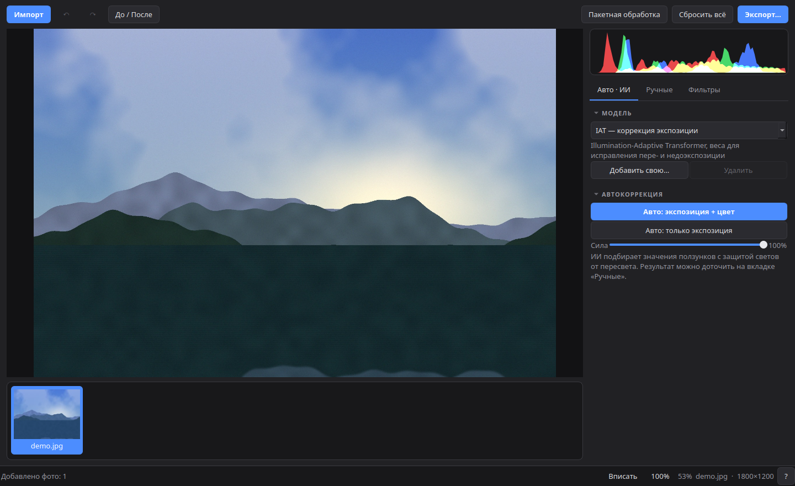
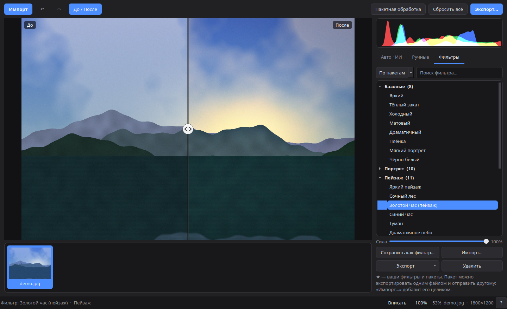
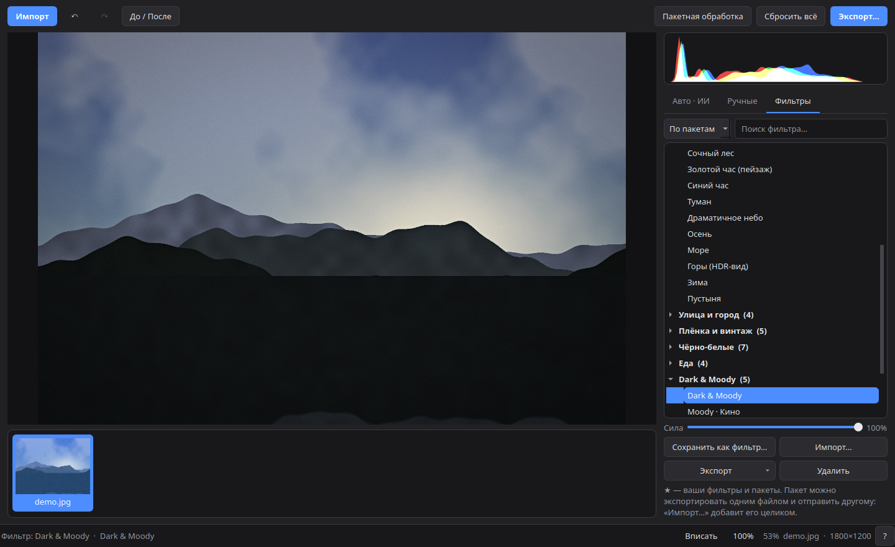
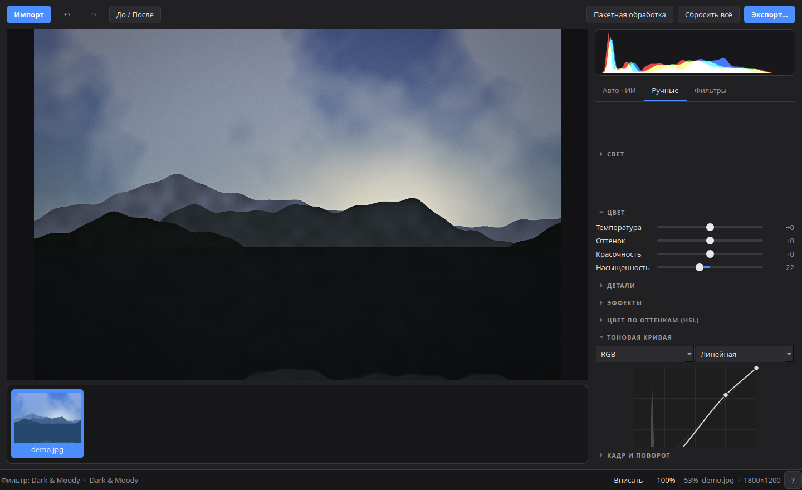

# Photo Editor AI

[English](README.md) · **Русский**

**Photo Editor AI** — бесплатный фоторедактор с открытым кодом: **ИИ-автокоррекция**, тоновая кривая как в Photoshop, HSL, **пакеты фильтров** с импортом и экспортом, каталог как в Lightroom и пакетная обработка.
Редактирование **неразрушающее**: оригиналы никогда не меняются, правки хранятся как настройки и применяются при экспорте.

> 🖥️ **Сначала Ubuntu.** Написан на Python, PySide6 (Qt) и ONNX Runtime, поэтому сборки для Windows и macOS запланированы. Всё работает **локально**: без облака и аккаунтов.

## Скриншоты
*(демонстрация на сгенерированном пейзаже)*






## ИИ-автокоррекция
На вкладке **Авто · ИИ** две кнопки: **экспозиция + цвет** или **только экспозиция**, плюс ползунок *силы*.
- Результат — обычные ползунки (экспозиция, баланс белого, красочность), поэтому его можно доточить вручную.
- Это не просто вставка результата нейросети: оценка ИИ усредняется с анализом гистограммы и **ограничивается так, чтобы света не пересвечивались**.
- **Модели** (первая встроена, остальные скачиваются по запросу с проверкой SHA-256):

  | Модель | Размер | Для чего |
  |---|---|---|
  | **Встроенная (гистограмма)** | — | Без нейросети, работает всегда |
  | **IAT — экспозиция** | 0,5 МБ | Исправляет пере- и недоэкспозицию (по умолчанию, если установлена) |
  | **IAT — тёмные снимки** | 0,5 МБ | Тёмные кадры; осветляет сильнее |
  | **Своя ONNX-модель** | — | «Добавить свою…» сама определяет вид (предсказатель EV или картинка→картинка) и проверяет её тестовым прогоном |

  Модели IAT — официальные веса [Illumination-Adaptive Transformer](https://github.com/cuiziteng/Illumination-Adaptive-Transformer) (Apache 2.0), конвертированные в ONNX; см. [NOTICE](NOTICE) и `scripts/export_iat.py`.

## Ручные настройки
- **Свет:** экспозиция, контраст, света, тени, белые, чёрные. **Цвет:** температура, оттенок, красочность, насыщенность.
- **Тоновая кривая как в Photoshop:** клик в любом месте кривой создаёт точку, и её можно тянуть; `Ctrl`+клик или `Delete` удаляют; стрелки сдвигают; чёрная и белая точки двигаются; каналы RGB / R / G / B, готовые формы и гистограмма под кривой.
- **HSL** по 8 цветам (оттенок, насыщенность, яркость), **детали** (резкость, текстура, чёткость, цветовой шум) и **эффекты** (дымка, виньетка, зерно).
- **Кадр и поворот:** интерактивная рамка с пропорциями, поворот на 90°, отражения, выравнивание горизонта.
- Перетаскиваемый ползунок **«До / После»**, масштаб колесом мыши, живая гистограмма, **отмена и повтор** (`Ctrl+Z`).
- Плавно даже с тяжёлыми фильтрами: пока тянете ползунок — быстрый черновик, чёткая версия дорисовывается в фоне.
- **RAW** (CR2, CR3, NEF, ARW, DNG, ORF, RAF, RW2, PEF и другие) через rawpy / LibRaw.

## Фильтры и пакеты
**60 встроенных фильтров в 9 пакетах**: Базовые, Портрет, Пейзаж, Улица и город, Плёнка и винтаж, Чёрно-белые, Еда, Dark & Moody и виды, подобранные численно по парам «до/после».
- **Группировка** по *пакетам*, по *типам* (Портрет, Пейзаж, Ч/Б, Кино, Плёнка, …) или списком; **поиск** по названию, пакету и типу.
- Ползунок **силы** смешивает фильтр с оригиналом.
- **Свои фильтры** сохраняются в свой пакет (новый пакет создаётся сам) с выбранным типом.
- **Обмен:** один фильтр или **весь пакет** экспортируется одним файлом `.pack.json`; «Импорт…» добавляет фильтры, пакеты и `.cube` (LUT). Чужие файлы проверяются, пути к LUT из недоверенных файлов игнорируются.
- Фильтры не трогают кадрирование и поворот.

<details><summary>Формат файла пакета</summary>

```json
{ "format": "photo-editor-ai-pack", "version": 1, "name": "Мой пакет", "description": "…",
  "filters": [ { "name": "Тёплый", "category": "Портрет", "params": { "temperature": 0.2, "contrast": 0.1 } } ] }
```
Один фильтр: `"format": "photo-editor-ai-filter"` с полями `name`, `category`, `params`. Не указанные параметры остаются по умолчанию.
</details>

## Каталог, импорт и экспорт
- **Импорт как в Lightroom:** выберите файлы или папку, отметьте миниатюры, затем *добавить на месте* или *копировать* (по желанию в папки по датам из EXIF). Работает и перетаскивание файлов в окно.
- **Лента** снимков под фото, **рейтинг звёздами** (`0`–`5`), убрать из каталога (`Delete`, файл остаётся), копирование и вставка настроек между фото, применить ко всем.
- **Экспорт:** JPEG, PNG, WebP, TIFF; качество, размер по длинной стороне, сохранение EXIF.
- **Пакетная обработка:** ИИ-автокоррекция и/или настройки открытого фото для целой папки, с выбором формата, размера и EXIF. Битый файл не останавливает пакет.

## Клавиши
`Ctrl+I` импорт · `Ctrl+S` экспорт · `Ctrl+Z` / `Ctrl+Shift+Z` отмена / повтор · `\` до/после · колесо мыши — масштаб · `Ctrl+0` / `Ctrl+1` вписать / 100% · `Alt+←/→` предыдущее/следующее фото · `0`–`5` рейтинг · `Ctrl+Shift+C/V` копировать/вставить настройки · `Enter` / `Esc` применить/отменить кадр · `F1` справка.

## Скачать (Python не нужен)
Файл для Ubuntu и систем на базе Debian — на странице [**Releases**](https://github.com/nikweel/photo-editor-ai/releases/latest):
- **`.deb`** — `sudo apt install ./Photo-Editor-AI-<версия>-amd64.deb`
- **`.AppImage`** — `chmod +x Photo-Editor-AI-*.AppImage && ./Photo-Editor-AI-*.AppImage`

Установленная программа хранит каталог, фильтры и модели в `~/.local/share/Photo-Editor-AI/`. Контрольные суммы лежат в `SHA256SUMS.txt`. Сборок для Windows и macOS пока нет.

## Запуск из исходников (Ubuntu)
Нужен [uv](https://docs.astral.sh/uv/) (он сам установит Python).
```bash
git clone https://github.com/nikweel/photo-editor-ai.git
cd photo-editor-ai
uv sync
uv run python -m app.main            # или: uv run python -m app.main photo.jpg
```
- Всё хранится рядом с проектом (портативно): каталог и ваши фильтры в `data/`, модели в `models/`.
- При первом нажатии «Авто» программа предложит скачать выбранную ИИ-модель (0,5 МБ) со страницы [Releases](https://github.com/nikweel/photo-editor-ai/releases).
- Если Qt не запускается под X11, установите `libxcb-cursor0` (`sudo apt install libxcb-cursor0`).

## Разработка
```bash
uv sync --group dev
uv run pytest -q
QT_QPA_PLATFORM=offscreen uv run python scripts/make_screenshots.py   # пересоздать скриншоты
```
Структура: `app/core` (движок изображения: кривые, HSL, микшер, детали, геометрия, LUT) · `app/ai` (модели и автокоррекция) · `app/services` (каталог, фильтры и пакеты, пакетная обработка, экспорт) · `app/gui` (интерфейс Qt) · `scripts` (экспорт моделей, скриншоты, подгонка фильтров).

## Планы
Сборки для Windows и macOS, локальные правки (маски и кисти), панель микшера каналов, больше ИИ-моделей, больше языков интерфейса.

## Лицензия
[MIT](LICENSE). Сторонние компоненты и веса модели IAT: см. [NOTICE](NOTICE).
